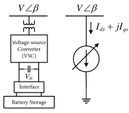
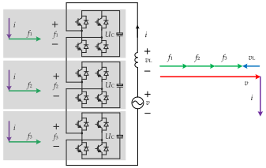
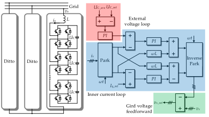
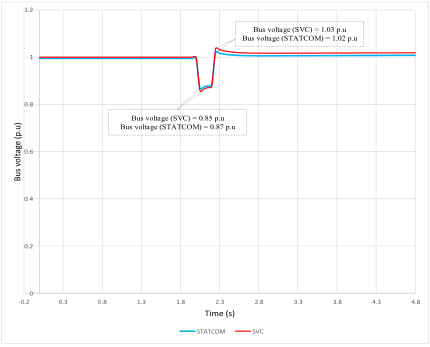
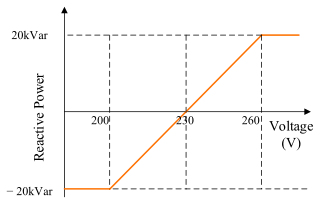
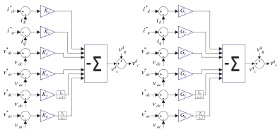
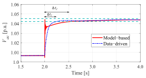
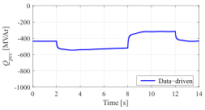
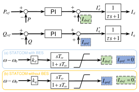

A **static synchronous compensator (STATCOM)** is a power-electronic device connected in shunt to an AC network. It injects or absorbs reactive current to regulate voltage and support power-system operation. It belongs to the **flexible AC transmission systems (FACTS)** family. Its central component is a voltage-source converter (VSC), which synthesizes an AC voltage from DC-side capacitors. [1](#ref-1)

The engineering value of a STATCOM depends on where it is installed, its usable current capability, and how its controller interacts with the surrounding network. A useful specification therefore describes the required behavior at the connection point, together with the conditions under which that behavior must be achieved. IEEE 1052 is a dedicated guide to specifying transmission STATCOM systems. [4](#ref-4)

This article explains the physical principles, construction, control options, applications, and study process. The nine figures are reproduced from published research papers, with the original figure number, paper link, and reuse licence beneath each one. Numerical worked examples are separately identified as analytical calculations; the reproduced response curves retain their original study conditions.

## Contents

- [1. Why power systems need reactive compensation](#why)
- [2. Construction and main components](#construction)
- [3. How a STATCOM exchanges reactive power](#operation)
- [4. Types of STATCOM](#types)
- [5. STATCOM versus SVC](#comparison)
- [6. What is a DSTATCOM?](#dstatcom)
- [7. Applications in modern power systems](#applications)
- [8. Control algorithms and representative papers](#control)
- [9. Sizing and selection through system studies](#sizing)
- [10. Problems that can appear after installation](#problems)
- [11. Research directions](#research)
- [12. What a good project specification should achieve](#specification)
- [References and source links](#references)

## 1. Why power systems need reactive compensation

In balanced sinusoidal operation, active power $$P$$ represents net energy transfer, while reactive power $$Q$$ describes the exchange associated with the quadrature component of current. The apparent-power magnitude is

$$
|S|=\sqrt{P^2+Q^2},\qquad \mathrm{pf}=\frac{P}{|S|}.
$$

Motors and transformers usually draw inductive reactive power. Cables and capacitor banks can supply capacitive reactive power. The required balance changes with loading, network configuration, and disturbances. Reactive resources must be sufficient in the relevant operating states, with enough dynamic support available when the network is disturbed. [3](#ref-3)

Two elementary circuit relationships explain why local compensation matters. At fixed active power and voltage,

$$
I=\frac{P}{\sqrt{3}\,V_{LL}\,\mathrm{pf}}.
$$

A lower power factor therefore means a higher upstream current. Also, for a simple radial branch with modest voltage drop and angle difference, a first-order per-unit approximation is

$$
\Delta v\approx\frac{r p+x q}{v}.
$$

Here $$p,q>0$$ denote downstream demand, and $$r+jx$$ is branch impedance. Reducing the reactive power transported through an inductive branch tends to reduce its voltage drop. In a distribution feeder with appreciable resistance, active power also has a significant effect on voltage. These are circuit approximations, not substitutes for a network load flow.

A STATCOM becomes attractive when the required compensation must change rapidly or continuously. Its controller can respond to voltage variations or changing loads by adjusting converter current. Depending on the specified functions, it can also address flicker, unbalance, and selected harmonics. These services have to be designed and rated explicitly. [1](#ref-1), [11](#ref-11)

**Reactive power capability and stored energy are different quantities.** A conventional STATCOM draws a small amount of active power to cover losses. Its ordinary DC capacitors do not make it a sustained source of MW. Dedicated storage changes that capability and requires a separate energy rating. [26](#ref-26)

## 2. Construction and main components

<figure class="paper-figure" id="figure-1">
  
  <figcaption><strong>Figure 1.</strong> STATCOM construction and the controlled-current-source equivalent used in the paper. The battery and interface represent the storage-equipped variant; they are optional additions to an ordinary capacitor-based STATCOM. This is a system-level model. Reproduced from Tu, Li and Xiang (2019), original Figure 1, <a href="https://doi.org/10.3390/en12244715"><em>Analysis, Control and Optimal Placement of Static Synchronous Compensator with/without Battery Energy Storage</em></a> <a href="#ref-30">[30]</a>. © The source authors; <a href="https://creativecommons.org/licenses/by/4.0/">CC BY 4.0</a>. Cropped from the published PDF and converted to SVG; original artwork and plotted data retained.</figcaption>
</figure>

The principal electrical path connects the converter to the point of common coupling (PCC) through coupling impedance and, where required, a transformer. A practical installation also needs measurement, control, protection, and auxiliary equipment. The following table explains their roles; the exact arrangement depends on voltage, topology, and project requirements. [4](#ref-4), [7](#ref-7)

| Component | Purpose in the installation |
|---|---|
| Voltage-source converter | Uses controllable semiconductor valves to produce the commanded AC waveform. |
| DC-link or cell capacitors | Maintain the voltages needed for conversion and accommodate internal energy variation. Modular converters distribute capacitance among cells. |
| Coupling reactor | Provides the impedance across which converter voltage controls current; contributes to switching-ripple attenuation. |
| Coupling transformer, where used | Matches the converter voltage to the grid and establishes the selected insulation and connection arrangement. Its leakage reactance contributes to coupling impedance. |
| Switchgear and protection | Connect, isolate, and protect the converter branch and associated equipment. |
| Voltage and current measurements | Supply feedback for regulation, protection, monitoring, and performance verification. |
| Control and modulation | Translate operating objectives into converter commands while enforcing internal limits and balancing capacitor voltages. |
| Cooling and auxiliary supply | Remove semiconductor losses and supply the control, protection, and support equipment. |
| Filters or additional shunts, when required | Meet the harmonic duty or extend the capacitive/inductive operating range. |

A multilevel converter can reduce filtering requirements, but “multilevel” does not establish that a project needs no harmonic study. Siemens lists active filtering as an option for SVC PLUS; the required functionality must be identified in the project scope. [7](#ref-7)

The enclosure is a separate design choice. A valve hall, container, or modular outdoor arrangement describes the station layout; it does not define the compensator's electrical principle or control behavior.

## 3. How a STATCOM exchanges reactive power

### 3.1 The controllable-voltage principle

For an ideal balanced three-phase equivalent, let $$V$$ be the grid phase-to-neutral RMS voltage, $$E$$ the converter phase-to-neutral RMS voltage referred to the same side, and $$X$$ the per-phase coupling reactance. Let $$\delta$$ be the converter-voltage angle relative to the grid. Define current as positive **from the converter into the grid** and define positive $$Q$$ as capacitive injection.

Starting from the lossless branch equation and grid-side complex power,

$$
\underline I=\frac{Ee^{j\delta}-V}{jX},\qquad
S_{\mathrm{inj}}=3V\underline I^*,
$$

we obtain

$$
P_{\mathrm{inj}}=\frac{3VE}{X}\sin\delta,
\qquad
Q_{\mathrm{inj}}=\frac{3V(E\cos\delta-V)}{X}.
$$

For $$\delta\approx0$$, the reactive exchange is governed mainly by the voltage-magnitude difference. A converter voltage above the grid voltage gives positive reactive injection; a lower converter voltage gives absorption. OPAL-RT describes the same equivalent using a receiving-device sign convention; the signs here follow the explicitly defined injection convention. [2](#ref-2)

<figure class="paper-figure" id="figure-2">
  
  <figcaption><strong>Figure 2.</strong> A published CHB circuit and its ideal inductive-mode phasors. The source current arrow points from the grid into the converter; current lags voltage in this absorption case. The equations in this article use the positive-injection convention defined above. Reproduced from Xu, Chen and Dai (2020), original Figure 4, <a href="https://doi.org/10.3390/en13051052"><em>Carrier-Phase-Shifted Rotation Pulse-Width-Modulation Scheme for Dynamic Active Power Balance of Modules in Cascaded H-Bridge STATCOMs</em></a> <a href="#ref-31">[31]</a>. © The source authors; <a href="https://creativecommons.org/licenses/by/4.0/">CC BY 4.0</a>. Cropped from the published PDF and converted to SVG; original artwork and plotted data retained.</figcaption>
</figure>

Real equipment imports active power to replace losses and maintain capacitor energy. Its coupling resistance, transformer, modulation range, capacitor-voltage limits, and thermal limits all affect the operating envelope. The ideal equations explain the mechanism; they do not define a complete equipment capability curve.

### 3.2 Reactive current, voltage, and available MVAr

For balanced fundamental-frequency reactive current,

$$
|Q|=\sqrt{3}\,V_{LL}|I_Q|.
$$

If available reactive current is limited to $$I_{\max}$$, the approximate maximum reactive-power magnitude is

$$
|Q_{\max}|\approx\sqrt{3}\,V_{LL}I_{\max}.
$$

Consequently, maintaining current during a voltage depression does **not** mean maintaining the nominal MVAr output. The linear voltage dependence in this approximation is central to the comparison with an SVC in Section 5. The actual ride-through envelope must also permit operation at the depressed voltage. [2](#ref-2)

### 3.3 A transparent compensation example

Consider an illustrative balanced load of **40 MW**, operating at **0.85 lagging power factor**. Suppose the objective is **0.98 lagging** at the upstream connection. From the power triangle,

$$
Q_c=P\left[\tan(\cos^{-1}\mathrm{pf}_1)
-\tan(\cos^{-1}\mathrm{pf}_2)\right].
$$

The independently calculated values are:

| Quantity | Before compensation | After compensation |
|---|---:|---:|
| Load active power | 40.00 MW | 40.00 MW |
| Reactive power supplied from upstream | 24.79 MVAr | 8.12 MVAr |
| Apparent power supplied from upstream | 47.06 MVA | 40.82 MVA |
| Power factor | 0.85 lagging | 0.98 lagging |

The compensator supplies **16.67 MVAr**. With unchanged voltage and active power, upstream current becomes $$0.85/0.98=0.8673$$ of its previous value. The associated $$I^2R$$ loss in the same upstream resistance becomes approximately 0.7523 of its previous value, a **24.77% reduction in that particular loss component**. This is not a prediction of total-site energy savings: converter losses, auxiliary consumption, and other network losses are excluded.

This example estimates one steady-state operating point. It does not determine the required inductive capability, transient current, harmonic duty, or reserve for disturbances.

## 4. Types of STATCOM

STATCOMs can be classified by converter circuit, network application, control behavior, and energy arrangement. These classifications overlap: a distribution STATCOM can use a multilevel converter, and a multilevel STATCOM can use either grid-following or grid-forming control.

### 4.1 Converter topologies

<figure class="paper-figure" id="figure-3">
  
  <figcaption><strong>Figure 3.</strong> CHB-STATCOM power circuit and dual-loop control arrangement from the authors&#x27; carrier-rotation PWM study. Individual H-bridge modules have their own DC capacitors. The paper also reports a downscaled experimental prototype. Reproduced from Xu, Chen and Dai (2020), original Figure 1, <a href="https://doi.org/10.3390/en13051052"><em>Carrier-Phase-Shifted Rotation Pulse-Width-Modulation Scheme for Dynamic Active Power Balance of Modules in Cascaded H-Bridge STATCOMs</em></a> <a href="#ref-31">[31]</a>. © The source authors; <a href="https://creativecommons.org/licenses/by/4.0/">CC BY 4.0</a>. Cropped from the published PDF and converted to SVG; original artwork and plotted data retained.</figcaption>
</figure>

| Topology | Basic arrangement | Engineering implications |
|---|---|---|
| Two-level VSC | A three-phase bridge switches each phase terminal between two DC-bus levels. | Relatively simple circuit; waveform quality depends on switching and filtering design. |
| Three-level neutral-point-clamped (NPC) | A split DC bus and clamping arrangement introduce a neutral voltage level. | More output levels; neutral-point voltage must be managed. The original NPC work predates its STATCOM applications. [9](#ref-9) |
| Cascaded H-bridge (CHB) | Series-connected full-bridge cells have individual DC capacitors; phase branches may use star or delta arrangements. | Modular voltage synthesis; cell and phase energy balancing become central control tasks. [8](#ref-8), [15](#ref-15) |
| Six-arm MMC | Each phase has upper and lower arms containing series submodules and arm inductance. | Supports modular voltage synthesis; arm energy and circulating-current behavior require control. The exact submodule and DC-side arrangement must be specified. [28](#ref-28) |

Terminology needs care. Some literature and supplier descriptions use **MMC** broadly for modular cascaded structures, including chain-link designs. CHB and MMC are therefore not always mutually exclusive labels. A technical description should state the actual circuit, such as single-delta full-bridge chains or a six-arm converter. [10](#ref-10), [15](#ref-15)

### 4.2 Compensation and energy arrangements

**Conventional STATCOM.** The converter exchanges reactive current and maintains its capacitor voltages, with active-power import for losses. Its stored energy is limited.

**Hybrid STATCOM.** A converter operates with additional capacitors or reactors. Thyristor-switched or mechanically switched branches can extend the total range, including asymmetric capacitive and inductive requirements. The converter and branches require coordinated control. [6](#ref-6)

**Energy-enhanced STATCOM.** Batteries, supercapacitors, or another suitable energy source support active-power exchange as well as reactive services. Both converter power and usable stored energy must be rated. Siemens distinguishes its ordinary STATCOM from the storage-equipped E-STATCOM on this basis. [25](#ref-25)

**Grid-following and grid-forming STATCOMs.** These terms describe control behavior. A grid-following design synchronizes to the measured grid and regulates current. A grid-forming design maintains an internal voltage reference with the intended voltage-source behavior. Neither label, by itself, specifies available energy, overload capability, or islanded operating duty. [25](#ref-25), [26](#ref-26)

## 5. STATCOM versus SVC

A **static var compensator (SVC)** regulates the effective susceptance of a shunt installation using reactors, capacitors, and thyristor switching or control. Typical branches include a thyristor-controlled reactor (TCR), thyristor-switched capacitors (TSC), and harmonic filters. A STATCOM regulates converter current through controlled voltage synthesis. [5](#ref-5)

| Aspect | STATCOM | Conventional thyristor SVC |
|---|---|---|
| Main principle | Voltage-source converter behind coupling impedance | Variable shunt susceptance |
| Main equipment | Converter valves, capacitors, reactors, and associated connection equipment | Thyristor-controlled/switched reactive branches and filters |
| Low-voltage capacitive limit, simplified | $$Q_{\max}\propto V$$ when current-limited | $$Q_{\max}\propto V^2$$ when maximum susceptance is reached |
| Dynamic behavior | Controlled by converter, measurements, regulation, and current limits | Controlled by measurements, regulation, and thyristor branch response |
| Harmonic considerations | Switching emissions and possible active filtering; project study remains necessary | TCR harmonics and filter/network interaction require assessment |
| Physical arrangement | Can be compact, particularly with multilevel conversion | Reactive branches and filtering can require substantial space |
| Choice for a project | Evaluate required current response, voltage envelope, functions, and lifecycle cost | Evaluate the same duty; an SVC may remain a suitable solution |

The circuit comparison follows [2](#ref-2) and [5](#ref-5). The layout and filtering discussion is supported by [6](#ref-6) and [7](#ref-7). No universal response time, cost ratio, or efficiency advantage is assumed here.

### Why the difference matters during a voltage dip

Normalize both devices to a capacitive output of 100 MVAr at 1.0 p.u. voltage. For an ideal STATCOM with 1.0 p.u. current available,

$$
Q_{\mathrm{STATCOM,pu}}=V_{\mathrm{pu}}.
$$

For an SVC at its fixed maximum capacitive susceptance,

$$
Q_{\mathrm{SVC,pu}}=V_{\mathrm{pu}}^2.
$$

At **0.5 p.u. voltage**, these assumptions give **50 MVAr** for the STATCOM and **25 MVAr** for the SVC. These are calculated capability limits; they are not a simulated fault-recovery result. Actual performance also depends on the permitted voltage range, protection, current allocation, and converter-voltage capability.

A complementary comparison is a simulated fault response. Tariq and colleagues model compensation devices in a particular substation; the figure below shows their bus-voltage result. [32](#ref-32)

<figure class="paper-figure" id="figure-4">
  
  <figcaption><strong>Figure 4.</strong> PowerFactory simulation comparing SVC and STATCOM: a short circuit is applied at the BB-5 11 kV bus at 2 s, and voltage is plotted at the BB-2 132 kV bus. The network model, ratings, and controller settings belong to that study. The curves show a time-domain case, separate from the equal-rating analytical capability comparison above. Reproduced from Tariq et al. (2022), original Figure 10, <a href="https://doi.org/10.3390/en15124453"><em>Comparative Analysis of Reactive Power Compensation Devices in a Real Electric Substation</em></a> <a href="#ref-32">[32]</a>. © The source authors; <a href="https://creativecommons.org/licenses/by/4.0/">CC BY 4.0</a>. Cropped from the published PDF and converted to SVG; original artwork and plotted data retained.</figcaption>
</figure>

Product names can be misleading: **SVC Light** and **SVC PLUS** are commercial names used for STATCOM technology. The words “SVC” in a product name do not identify a conventional thyristor SVC. [6](#ref-6), [7](#ref-7)

## 6. What is a DSTATCOM?

A **distribution STATCOM (DSTATCOM)** applies shunt converter compensation in a distribution network or at an industrial load connection. Its objectives often include power-factor correction, phase-current balancing, and power-quality improvement. Singh and Solanki compared reference-current extraction methods for reactive and unbalanced-load compensation using simulations and experiments. [11](#ref-11)

The connection arrangement determines which currents the device can compensate. A three-wire converter cannot independently inject a zero-sequence current into a four-wire network without an appropriate return path. A four-leg converter supplies an additional controlled path for neutral current; Srikanthan and Mishra analyzed such a DSTATCOM using simulation. [12](#ref-12)

Another arrangement combines a VSC with a zigzag transformer. Singh and colleagues studied this configuration to provide a zero-sequence path and reduce the converter burden in a three-phase, four-wire system. Their reported validation was simulation-based. The transformer, grounding, thermal rating, and harmonic duty remain essential parts of that design. [13](#ref-13)

“DSTATCOM” therefore identifies the application context more than a unique circuit. Its performance should be specified at the actual PCC: which phase currents, voltage components, harmonic orders, and power-factor targets are to be controlled, and under what loading conditions?

A distribution application may regulate voltage through a local reactive-power characteristic. Figure 5 reproduces the Q–V setting used by Rahman and colleagues for a low-voltage feeder with solar PV. Its sign convention is stated in the caption. [33](#ref-33)

<figure class="paper-figure" id="figure-5">
  
  <figcaption><strong>Figure 5.</strong> Q–V droop chosen for a four-wire low-voltage feeder study: 230 V is the zero-reactive-power reference and the limits are ±20 kVAr. In this paper, positive Q means absorption and negative Q means injection. These numerical settings are specific to the studied feeder. Reproduced from Rahman, Robinson and Elphick (2025), original Figure 11, <a href="https://doi.org/10.3390/electronics14153063"><em>Mitigation of Solar PV Impact in Four-Wire LV Radial Distribution Feeders Through Reactive Power Management Using STATCOMs</em></a> <a href="#ref-33">[33]</a>. © The source authors; <a href="https://creativecommons.org/licenses/by/4.0/">CC BY 4.0</a>. Cropped from the published PDF and converted to SVG; original artwork and plotted data retained.</figcaption>
</figure>

## 7. Applications in modern power systems

The following applications involve different engineering objectives. Meeting one objective does not establish all the others.

| Application | Intended contribution | Important boundary |
|---|---|---|
| Transmission voltage support | Reactive support during operating changes and disturbances; improved voltage recovery or transfer margin | Depends on location, dynamic reserve, and network constraints. [3](#ref-3) |
| Wind and solar connections | Coordinate PCC voltage and reactive-power behavior with plant controls | Study interactions with plant converters and the surrounding network. Battery-based STATCOM research demonstrates why control architecture matters. [19](#ref-19) |
| Electric arc furnaces | Compensate rapidly changing reactive demand, flicker, and unbalanced currents | Harmonic and unbalance functions require explicit current capacity. [27](#ref-27) |
| Industrial and distribution loads | Improve power factor and selected current-quality measures | Required topology depends on three-wire/four-wire operation. [11](#ref-11), [12](#ref-12) |
| Weak-grid voltage-source support | Use suitably designed grid-forming behavior to improve system response | Current limits and interaction studies remain decisive. [21](#ref-21), [25](#ref-25) |
| Rapidly varying active-power loads | An energy-enhanced STATCOM can exchange short-term active power while providing reactive support | Requires dedicated storage, a defined cycle, and sufficient converter headroom. [28](#ref-28) |

Two field examples help distinguish established applications from research demonstrations. Siemens reports grid-forming SVC PLUS installations at Rheinau, Germany. Separately, the AISTech 2024 abstract by Rasmussen, Bertilsson, and Elm describes a STATCOM installed at a Cardiff steel plant for electric-arc-furnace compensation, with grid-forming functionality and power-quality measurements. These are supplier/conference reports of installations; they do not justify a universal performance improvement percentage. [25](#ref-25), [27](#ref-27)

The wider power-system effect must be assessed against the original problem. Lower upstream reactive flow can reduce current, as the worked example shows. Better voltage recovery can prevent a specific voltage-driven failure mechanism. Conversely, the system may remain limited by active-power availability, thermal ratings, protection, or another instability. A STATCOM's usefulness is measured by the relevant system outcome.

## 8. Control algorithms and representative papers

### 8.1 A controller contains several layers

A practical controller must decide what service to provide, calculate the required current or voltage commands, regulate the converter, and maintain internal operating limits. These tasks should be distinguished when comparing algorithms.

Figure 6 gives one published controller implementation: the data-driven design evaluated by Rivera and colleagues. [34](#ref-34)

<figure class="paper-figure" id="figure-6">
  
  <figcaption><strong>Figure 6.</strong> Data-driven STATCOM control structure used in the authors&#x27; two-area test-system study. The feedback signals and gains belong to that controller design. Reproduced from Rivera et al. (2021), original Figure 3, <a href="https://doi.org/10.3390/math9192361"><em>Power Grid Dynamic Performance Enhancement via STATCOM Data-Driven Control</em></a> <a href="#ref-34">[34]</a>. © The source authors; <a href="https://creativecommons.org/licenses/by/4.0/">CC BY 4.0</a>. Cropped from the published PDF and converted to SVG; original artwork and plotted data retained.</figcaption>
</figure>

For example, synchronous-reference-frame processing expresses balanced fundamental quantities as approximately constant values in rotating $$d$$- and $$q$$-axes. This makes PI regulation convenient. Reference extraction determines the compensation request; the current regulator then tries to track it. A separate energy-control function maintains the DC or cell-capacitor voltages. The modulator converts commands into switching actions.

This hierarchy explains why PWM, an adaptive reference extractor, and a predictive current controller are not three interchangeable alternatives. They can occupy different layers of the same system. Geyer and colleagues, for example, use an MPC layer followed by PWM and balancing control. [15](#ref-15)

### 8.2 Control methods: purpose, evidence, and limits

| Method or family | Role and useful feature | Representative source and evidence | Main issue to examine |
|---|---|---|---|
| PI and linear feedback control | Regulate current, voltage, or energy about an operating condition; provide a clear comparison baseline | Rao, Yang, and Crow compare PI and feedback strategies on an example system. [14](#ref-14) | Tuning, coupling, saturation, and performance away from the design point |
| Instantaneous-power and synchronous-reference-frame methods | Extract reference currents for reactive and unbalanced-load compensation | Singh and Solanki compare both methods and Adaline extraction with simulation and experiment. [11](#ref-11) | Distorted/unbalanced voltage, filtering delay, and the chosen compensation objective |
| Hysteresis current control | Directly tracks current within a band | Four-leg DSTATCOM modeling by Srikanthan and Mishra; simulation evidence. [12](#ref-12) | Switching-frequency variation, losses, and implementation constraints |
| Proportional-resonant and sequence-aware control | Supports sinusoidal-current tracking and selected sequence objectives | Chen and Su investigate negative-sequence compensation with experimental results. [17](#ref-17) | Network impedance, phase-current burden, and competing objectives |
| Model predictive control (MPC) | Predicts converter behavior and optimizes commands subject to modeled constraints | Geyer et al.: modular STATCOM study; Rodriguez et al.: low-capacitance CHB control with laboratory validation. [15](#ref-15), [16](#ref-16) | Model accuracy, computation time, delays, feasibility, and constraint implementation |
| Data-driven feedback control | Derives feedback gains from recorded input/output data | Rivera et al. compare their controller with a model-based baseline in a simulated two-area, four-machine system. [34](#ref-34) | Quality and coverage of the data, design assumptions, current limits, delays, and behavior outside the tested cases |
| Nonlinear adaptive control | Updates control actions or parameters to address modeled uncertainty | Milasi develops a nonlinear adaptive STATCOM controller with hardware-in-the-loop and experimental implementation. [18](#ref-18) | Scope of the stability proof and robustness to effects outside the assumed model |
| Grid-forming control | Maintains an internal voltage reference and specified voltage-source behavior | Zhao et al.: battery-based STATCOM small-signal/EMT comparison; field implementations are separately reported. [19](#ref-19), [27](#ref-27) | Current limiting, energy availability, synchronization, and post-fault recovery |

An algorithm comparison is useful only if the constraints are comparable. As an engineering recommendation, compare controllers using the same converter, current limits, grid cases, sampling and computation delays, disturbance set, and performance measures. Report execution time and limiting behavior as well as tracking error. A laboratory result establishes more than an untested simulation, but it still does not establish performance at a different voltage, topology, or network scale.

The next two figures retain the actual simulation results reported by Rivera et al.: voltage tracking and the associated PCC reactive-power trajectory. They illustrate why a controller comparison needs both the requested voltage behavior and the resulting reactive-power demand. [34](#ref-34)

<figure class="paper-figure" id="figure-7">
  
  <figcaption><strong>Figure 7.</strong> Simulated AC-voltage response to a reference step in the paper&#x27;s two-area, four-machine test system. The model-based and data-driven controllers are compared under that study&#x27;s conditions. Reproduced from Rivera et al. (2021), original Figure 6, <a href="https://doi.org/10.3390/math9192361"><em>Power Grid Dynamic Performance Enhancement via STATCOM Data-Driven Control</em></a> <a href="#ref-34">[34]</a>. © The source authors; <a href="https://creativecommons.org/licenses/by/4.0/">CC BY 4.0</a>. Cropped from the published PDF and converted to SVG; original artwork and plotted data retained.</figcaption>
</figure>

<figure class="paper-figure" id="figure-8">
  
  <figcaption><strong>Figure 8.</strong> Simulated reactive power at the PCC during the authors&#x27; voltage-reference sequence. Negative Qpcc denotes reactive injection in the paper&#x27;s convention, opposite to this article&#x27;s positive Qinj convention. This is a PCC response trace for the reported network and operating point; its MVAr values do not specify a generic device rating. Reproduced from Rivera et al. (2021), original Figure 8, <a href="https://doi.org/10.3390/math9192361"><em>Power Grid Dynamic Performance Enhancement via STATCOM Data-Driven Control</em></a> <a href="#ref-34">[34]</a>. © The source authors; <a href="https://creativecommons.org/licenses/by/4.0/">CC BY 4.0</a>. Cropped from the published PDF and converted to SVG; original artwork and plotted data retained.</figcaption>
</figure>

### 8.3 Current priority and droop

When voltage support, harmonic compensation, negative-sequence control, and active-power exchange are requested together, they share semiconductor and thermal capacity. Sequence-aware research explicitly considers this current burden, while constrained MPC addresses internal operating limits. [15](#ref-15), [17](#ref-17)

For a simple balanced reactive-current regulator, an illustrative droop law is

$$
i_Q^*=\operatorname{clip}\!\left(
\frac{v_{\mathrm{ref}}-v}{k_d},
-i_{Q,\max},\;i_{Q,\max}\right),
$$

where positive $$i_Q^*$$ means capacitive support and $$k_d>0$$ sets the slope. Thus lower measured voltage requests more positive reactive current until a limit is reached. This is an explanatory control law, not a recommended numerical setting. The actual controller must coordinate droop, setpoints, anti-windup, and mode changes with other regulating equipment.

### 8.4 Grid-forming behavior and the energy constraint

Grid-forming control does not remove the converter's physical limits. A current limiter must protect the valves while preserving useful behavior during a disturbance. Wang, Xu, and Li propose variable virtual impedance for an energy-storage STATCOM and validate their approach through simulations. That result should be read within its tested fault cases. [21](#ref-21)

For a balanced converter, the current limit gives the approximate grid-terminal envelope

$$
P^2+Q^2\leq\left(\sqrt{3}\,V_{LL}I_{\max}\right)^2.
$$

In per unit, with consistent bases and $$I_{\max}=1$$, its radius is 1.0 at nominal voltage and 0.7 at 0.7 p.u. voltage. This is a **current envelope**, not a guarantee that all points are energetically sustainable. Additional voltage and thermal constraints can reduce it.

Supplying **10 MW for 2 seconds** requires at least

$$
E=P\Delta t=20\ \mathrm{MJ}=5.56\ \mathrm{kWh}
$$

of delivered energy. Actual storage must also account for losses, usable voltage or state-of-charge range, reserve, recharge time, and repeated events. For a capacitor,

$$
E_{\mathrm{usable}}=\tfrac12 C\left(V_{\max}^2-V_{\min}^2\right).
$$

The required MW, duration, and permitted repetition rate are therefore separate specification inputs. An ordinary STATCOM should not be assigned sustained frequency-support or black-start duties simply because its controller is described as grid-forming. [26](#ref-26), [29](#ref-29)

Storage also changes the control options available for oscillation damping. Tu, Li and Xiang study active-current modulation with a battery and reactive-current modulation without one. Figure 9 reproduces their supplementary damping design. [30](#ref-30)

<figure class="paper-figure" id="figure-9">
  
  <figcaption><strong>Figure 9.</strong> Supplementary damping controllers studied with and without battery energy storage. In this design, the battery-assisted case modulates active current, while the case without a battery modulates reactive current. The diagram retains the paper&#x27;s specific model and control assumptions. Reproduced from Tu, Li and Xiang (2019), original Figure 4, <a href="https://doi.org/10.3390/en12244715"><em>Analysis, Control and Optimal Placement of Static Synchronous Compensator with/without Battery Energy Storage</em></a> <a href="#ref-30">[30]</a>. © The source authors; <a href="https://creativecommons.org/licenses/by/4.0/">CC BY 4.0</a>. Cropped from the published PDF and converted to SVG; original artwork and plotted data retained.</figcaption>
</figure>

## 9. Sizing and selection through system studies

The correct rating follows from a defined operating duty. The process below is an engineering synthesis; it is not a quotation from a standard. IEEE 1052 covers the relevant specification and study scope, while NERC and AEMO provide complementary system-study guidance. [4](#ref-4), [23](#ref-23), [24](#ref-24)

### Step 1 — Define the required service and operating cases

State what needs improvement: voltage deviation, fault recovery, reactive interchange, flicker, unbalance, harmonics, or oscillation damping. Describe the measurement location and acceptance criteria. Assemble minimum and maximum load, generation patterns, credible outages, future network states, and relevant load dynamics. This prevents a rating selected for one favorable operating point from being mistaken for an all-condition solution.

### Step 2 — Select location and establish steady-state needs

Use load flow to compare candidate buses and to quantify capacitive and inductive requirements. Coordinate existing shunts, transformer taps, generators, and plant controllers. Assess voltage/reactive sensitivity and practical connection constraints. Q–V and P–V analysis examine different margins: reactive support at a bus and loading or transfer capability. Acceptable pre-disturbance voltage alone does not establish adequate dynamic reserve. [3](#ref-3)

### Step 3 — Translate MVAr into current over the voltage range

Suppose the required capacitive output is **30 MVAr at a nominal 33 kV PCC**, and that output must still be delivered at **0.8 p.u. voltage**. The relevant voltage is 26.4 kV, giving

$$
I_Q=\frac{30\times10^6}{\sqrt{3}\times26.4\times10^3}
\approx656.1\ \mathrm{A}.
$$

That same current corresponds to **37.5 MVAr at nominal voltage**. A nominal 30 MVAr current rating would provide only 24 MVAr at 0.8 p.u. under the constant-current approximation. The 37.5 MVAr figure is a current-equivalent estimate, not a complete purchase rating: converter voltage, transformer/reactor demand, overload duration, temperature, other services, and margin still require assessment.

Specify the rating boundary explicitly. MVAr at the converter terminals and net MVAr delivered at the PCC are different because intervening equipment also exchanges reactive power. Capacitive and inductive duties need separate checks.

### Step 4 — Check dynamic recovery and control interactions

RMS dynamic studies can examine the relevant electromechanical and voltage-recovery behavior. EMT studies become important where fast controls, unbalance, limiting, switching-related phenomena, or neighboring converters materially affect the result. NERC's EMT guidance addresses model boundaries, nearby dynamic devices, and benchmarking; labeling a simulation “EMT” does not itself validate its models. [23](#ref-23)

Short-circuit ratio (SCR) is useful for screening, but a single scalar cannot describe every control interaction. AEMO's system-strength process uses detailed plant performance and model assessment. Its guidelines also distinguish a system-strength proxy from the actual fault-current calculation needed for breaker and protection studies. The Australian procedure is a useful example, not a universal design rule. [24](#ref-24)

### Step 5 — Check power quality, protection, and equipment duty

Evaluate harmonic emissions and background distortion over relevant network impedances and switching states. Where IEEE 519 applies, use its PCC-based harmonic framework together with the applicable connection agreement; no single THD value is asserted here as a universal requirement. [22](#ref-22)

Then check phase-current and neutral-current capability, grounding, insulation, transformer duty, thermal cycling, faults, and protection coordination. Include the behavior of current limiters and blocked or bypassed converter states. Set numerical acceptance criteria from the actual project requirements and agreed equipment capability.

### Step 6 — Compare alternatives and validate the selected design

Compare a STATCOM with the alternatives that can address the same problem: switched shunts, an SVC, a hybrid arrangement, a synchronous condenser, storage, network reinforcement, or changes to existing controls. The appropriate comparison includes capital cost, losses, maintenance, space, availability, and the required performance envelope.

Finally, connect the study model to the supplied controller and hardware. Agree model validation, factory tests, commissioning checks, disturbance recording, and the process for updating settings. A useful deliverable is a traceable chain from the original system problem to the chosen location, rating, control settings, and demonstrated behavior.

## 10. Problems that can appear after installation

Adding reactive capability can solve one problem while introducing a new interaction. The following risks should be tested where relevant; they are not claims that every STATCOM installation experiences them.

| Potential problem | Mechanism or concern | What to examine |
|---|---|---|
| Control oscillation | The added regulator interacts with another converter, PLL, or network mode | Coupled models, operating-point variation, damping, and settings coordination. Guo et al. document an LCC-HVDC/STATCOM weak-grid case. [20](#ref-20) |
| Current-limit saturation | Requested voltage support exceeds usable phase current | Limiting priority, anti-windup, recovery, and transient valve current. [21](#ref-21) |
| Harmonic amplification | Converter/filter behavior interacts with network impedance and background harmonics | Impedance scans, emissions, and the applicable PCC requirements. [22](#ref-22), [23](#ref-23) |
| Capacitor-energy imbalance | Unequal phase/cell energy or reduced capacitance increases internal excursions | Cell voltages, modulation limits, balancing, and constrained operation. [16](#ref-16) |
| Incomplete unbalance compensation | Correcting one current or voltage objective increases another phase's burden | Network impedance and per-phase limits; the compensation objective must be explicit. [17](#ref-17) |
| Inadequate neutral-current path | The selected topology cannot carry the required zero-sequence current | Four-leg or transformer arrangements, neutral/grounding design, and conductor duty. [12](#ref-12), [13](#ref-13) |
| Overestimated active-power service | Requested duration exceeds usable stored energy | MW, usable energy, recharge, and repeated-event duty. [28](#ref-28), [29](#ref-29) |

The LCC-HVDC example deserves attention because it directly answers whether a STATCOM can adversely affect a system. Guo, Jiang, and Zhao analyze a weak-grid case in which the STATCOM voltage controller and HVDC controls can contribute to small-signal instability. They investigate supplementary coordinated damping. The transferable lesson is to study the combined system; the result does not imply that STATCOMs are generally harmful to weak grids. [20](#ref-20)

Other practical checks follow from the specified operating duty. A capacitor-backed hybrid needs suitable behavior after a load rejection. Multiple voltage regulators need compatible setpoints and droop. Additional converter and cooling losses can offset part of the upstream loss reduction. Protection must use the actual converter fault response, including sequence behavior and blocking. These are engineering checks whose importance depends on the installation.

## 11. Research directions

The most useful research questions connect a proposed control or topology improvement to a measurable power-system benefit and its operating constraints.

### Grid-forming STATCOMs with explicit current and energy limits

Research is moving beyond nominal-condition voltage regulation toward controlled behavior during faults, phase jumps, weak-grid operation, and recovery. Storage changes the available services, but also introduces sizing and recharge questions. CIGRE Working Group B4.107's 2026 announcement identifies storage sizing, circuit arrangements, performance assessment, and requirements as active topics. It describes ongoing work, not an already completed technical brochure. [29](#ref-29)

### Constraint-aware control and reduced capacitance

MPC is attractive where current, capacitor voltage, and internal energy constraints need coordinated treatment. Rodriguez and colleagues provide a laboratory-validated example for a low-capacitance delta-connected CHB STATCOM. A useful research extension is to demonstrate that any reduction in capacitance remains acceptable across a wider disturbance and thermal duty, with realistic computation delays. [16](#ref-16)

### Robustness under uncertain and changing conditions

Adaptive control provides one route to addressing uncertain model parameters. Milasi's work combines a nonlinear formulation with hardware-in-the-loop and experimental implementation. Further evaluation should distinguish parameter uncertainty handled by the design from unmodeled effects, measurement errors, and actuator saturation. [18](#ref-18)

### Coordinated control of converter-dominated networks

Research on battery-based STATCOMs and on HVDC interactions shows that the same device cannot be evaluated independently of its network. Promising work includes coordination with renewable-plant controllers, multiple compensators, and other grid-forming resources across changing operating conditions. Claims of improved stability should identify the models, disturbances, and parameter ranges that support them. [19](#ref-19), [20](#ref-20)

### Multiple services with a finite current budget

Positive-sequence voltage support, negative-sequence compensation, harmonic filtering, and active-power exchange compete for hardware capacity. An important research problem is to allocate this capacity transparently during both normal operation and disturbances. Sequence-aware compensation [17](#ref-17) and constrained control [16](#ref-16) provide relevant foundations.

### Validation that explains the improvement

As an engineering recommendation, a convincing new method should be compared with a carefully tuned conventional baseline and should report the complete control delay, current peaks, capacitor-energy behavior, and recovery after limiting. Reproducible models and hardware or field evidence make it easier to determine whether an improvement comes from the proposed algorithm, a different rating, or more favorable assumptions. Simulation, laboratory validation, and field operation should remain clearly identified evidence levels.

## 12. What a good project specification should achieve

A useful STATCOM specification connects **the required service**, **the operating envelope**, and **the evidence of performance**. For example: how much net reactive current is needed at the PCC during a defined voltage depression; how long it must be sustained; what other services are active; and how the response will be verified.

The worked examples show why these distinctions matter. Correcting a 40 MW load from 0.85 to 0.98 lagging requires about 16.67 MVAr at that operating point. Delivering 30 MVAr at 0.8 p.u. voltage requires more current than a nominal 30 MVAr rating implies. Adding an active-power duty introduces an energy calculation as well as a converter-current calculation.

A well-chosen STATCOM is therefore a studied combination of location, converter capability, control, and system integration. Its rating should follow the problem it must solve, and its claimed benefits should be demonstrated under the conditions that matter to the network.

## References and source links

Sources checked on **31 October 2026**. The list combines official technical documentation, operator guidance, and original research. A source described as an abstract or scope page supports only the claims available there. Manufacturer descriptions are used for their own products and reported applications. All nine figures are reproduced from the CC BY 4.0 research papers identified in their captions. The artwork was extracted from the published PDFs, cropped to the figure area, and converted to SVG without redrawing the diagrams or regenerating the response curves. The captions identify the source figure number and preserve the distinction between a study result and an illustrative calculation.

**[1] ENTSO-E.** “Static Synchronous Compensator (STATCOM).” *Technopedia*, 25 March 2025. [Official technical overview](https://www.entsoe.eu/technopedia/techsheets/static-synchronous-compensator-statcom/).

**[2] OPAL-RT.** “Static Synchronous Compensator (Phasor Type).” *SPS Software documentation*, updated 15 October 2025. [Official model documentation](https://opal-rt.atlassian.net/wiki/spaces/PSPS/pages/1551733147/Static+Synchronous+Compensator+Phasor+Type). Its power/current signs differ from the injection convention used here.

**[3] NERC.** *Reliability Guideline: Reactive Power Planning*. December 2016; includes March 2017 errata. [Official PDF](https://www.nerc.com/globalassets/who-we-are/standing-committees/rstc/sams/reliability-guideline---reactive-power-planning.pdf). Used for engineering principles, not universal current regional thresholds.

**[4] IEEE.** *IEEE 1052-2018: IEEE Guide for Specification of Transmission Static Synchronous Compensator (STATCOM) Systems*. Published 19 April 2019. [Official scope and status](https://standards.ieee.org/ieee/1052/5530/); [2021 errata](https://standards.ieee.org/wp-content/uploads/import/documents/erratas/1052-2018_errata.pdf). The public scope was consulted; no inaccessible clause or numerical requirement is asserted.

**[5] Hitachi Energy.** “Static Var Compensator (SVC).” [Official technology page](https://www.hitachienergy.com/us/en/products-and-solutions/facts/static-var-compensation-svc).

**[6] Hitachi Energy.** “STATCOM — Hybrid.” [Official technical description](https://www.hitachienergy.com/us/en/products-and-solutions/facts/statcom/statcom-hybrid).

**[7] Siemens Energy.** *SVC PLUS: The Advanced STATCOM*. [Official technical sheet (PDF)](https://assets.siemens-energy.com/dam/292b5bec-253f-4b24-9890-b05800f192a8/DINA4SVCPLUSDatasheet-pdf_Original%20file.pdf).

**[8] F. Z. Peng, J.-S. Lai, J. W. McKeever, and J. VanCoevering.** “A Multilevel Voltage-Source Inverter with Separate DC Sources for Static VAr Generation.” *IEEE Transactions on Industry Applications*, 32(5), 1130–1138, 1996. [DOI: 10.1109/28.536875](https://doi.org/10.1109/28.536875). [Accessible preceding ORNL manuscript, 1995](https://digital.library.unt.edu/ark:/67531/metadc626026/).

**[9] A. Nabae, I. Takahashi, and H. Akagi.** “A New Neutral-Point-Clamped PWM Inverter.” *IEEE Transactions on Industry Applications*, IA-17(5), 518–523, 1981. [DOI: 10.1109/TIA.1981.4503992](https://doi.org/10.1109/TIA.1981.4503992); [publisher abstract](https://ieeexplore.ieee.org/document/4503992/). Foundational converter paper, not a STATCOM field study.

**[10] H. Akagi.** “Classification, Terminology, and Application of the Modular Multilevel Cascade Converter (MMCC).” *IEEE Transactions on Power Electronics*, 26(11), 3119–3130, 2011. [DOI: 10.1109/TPEL.2011.2143431](https://doi.org/10.1109/TPEL.2011.2143431).

**[11] B. Singh and J. Solanki.** “A Comparison of Control Algorithms for DSTATCOM.” *IEEE Transactions on Industrial Electronics*, 56(7), 2738–2745, 2009. [DOI: 10.1109/TIE.2009.2021596](https://doi.org/10.1109/TIE.2009.2021596); [institutional abstract](https://library.iitd.ac.in/research/publications/W2129057369/).

**[12] S. Srikanthan and M. K. Mishra.** “Modeling of a Four-Leg Inverter Based DSTATCOM for Load Compensation.” *POWERCON 2010*. [DOI: 10.1109/POWERCON.2010.5666751](https://doi.org/10.1109/POWERCON.2010.5666751); [institutional abstract](https://experts.umn.edu/en/publications/modeling-of-a-four-leg-inverter-based-dstatcom-for-load-compensat/).

**[13] B. Singh, P. Jayaprakash, T. R. Somayajulu, and D. P. Kothari.** “Reduced Rating VSC With a Zig-Zag Transformer for Current Compensation in a Three-Phase Four-Wire Distribution System.” *IEEE Transactions on Power Delivery*, 24(1), 249–259, 2009. [DOI: 10.1109/TPWRD.2008.2005398](https://doi.org/10.1109/TPWRD.2008.2005398); [institutional abstract](https://library.iitd.ac.in/research/publications/W2110667995/).

**[14] P. Rao, Z. Yang, and M. Crow.** “STATCOM Control for Power System Voltage Control Applications.” *IEEE Transactions on Power Delivery*, 15(4), 1311–1317, 2000. [DOI: 10.1109/61.891520](https://doi.org/10.1109/61.891520); [author-institution record](https://scholarsmine.mst.edu/ele_comeng_facwork/691/).

**[15] T. Geyer, G. Darivianakis, and W. van der Merwe.** “Model Predictive Control of a STATCOM Based on a Modular Multilevel Converter in Delta Configuration.” *EPE'15 ECCE-Europe*, 2015. [DOI: 10.1109/EPE.2015.7309148](https://doi.org/10.1109/EPE.2015.7309148); [author-hosted full paper (PDF)](https://www.tobiasgeyer.org/GeDM15_Statcom.pdf).

**[16] E. Rodriguez, R. Leyva, C. Townsend, G. Farivar, H. Dehghani Tafti, and J. Pou.** “Constrained Control of Low-Capacitance Delta Cascaded H-Bridge StatComs: A Model Predictive Control Approach.” *IEEE Transactions on Power Electronics*, 36(12), 14312–14328, 2021. [DOI: 10.1109/TPEL.2021.3085880](https://doi.org/10.1109/TPEL.2021.3085880); [institutional abstract](https://research-repository.uwa.edu.au/en/publications/constrained-control-of-low-capacitance-delta-cascaded-h-bridge-st/).

**[17] W. L. Chen and Y. H. Su.** “Negative-Sequence Active and Reactive Currents Compensation for Unbalanced Three-Phase Networks Subject to Various Line Impedance Attributes.” *IEEE Journal of Emerging and Selected Topics in Power Electronics*, 10(2), 2528–2538, 2022. [DOI: 10.1109/JESTPE.2021.3105197](https://doi.org/10.1109/JESTPE.2021.3105197); [institutional abstract](https://pure.lib.cgu.edu.tw/en/publications/negative-sequence-active-and-reactive-currents-compensation-for-u/).

**[18] R. M. Milasi.** “A Nonlinear Adaptive Control for a Bidirectional DC-AC Converter With Parameter Uncertainties.” *IEEE Transactions on Industrial Electronics*, 71(8), 9551–9558, 2024. [DOI: 10.1109/TIE.2023.3323703](https://doi.org/10.1109/TIE.2023.3323703); [institutional abstract](https://pure.psu.edu/en/publications/a-nonlinear-adaptive-control-for-a-bidirectional-dc-ac-converter-/).

**[19] F. Zhao, X. Wang, Z. Zhou, Ł. Kocewiak, and J. R. Svensson.** “Comparative Study of Battery-Based STATCOM in Grid-Following and Grid-Forming Modes for Stabilization of Offshore Wind Power Plant.” *Electric Power Systems Research*, 212, 108449, 2022. [DOI: 10.1016/j.epsr.2022.108449](https://doi.org/10.1016/j.epsr.2022.108449); [institutional abstract](https://vbn.aau.dk/en/publications/comparative-study-of-battery-based-statcom-in-grid-following-and-/).

**[20] C. Guo, W. Jiang, and C. Zhao.** “Small-Signal Instability and Supplementary Coordinated Damping-Control of LCC-HVDC System With STATCOM Under Weak AC Grid Conditions.” *International Journal of Electrical Power & Energy Systems*, 104, 246–254, 2019. [DOI: 10.1016/j.ijepes.2018.06.055](https://doi.org/10.1016/j.ijepes.2018.06.055); [publisher record](https://www.sciencedirect.com/science/article/abs/pii/S0142061518309566).

**[21] F. Wang, J. Xu, and G. Li.** “A Variable Virtual Impedance Current Limitation Strategy of Grid-Forming Energy Storage-STATCOM.” *IEEE Transactions on Power Delivery*, 39(6), 3450–3461, 2024. [DOI: 10.1109/TPWRD.2024.3476913](https://doi.org/10.1109/TPWRD.2024.3476913); [author manuscript (PDF)](https://backend.orbit.dtu.dk/ws/files/376825274/TPWRD-00751-2024_FINAL_VERSION.pdf).

**[22] IEEE.** *IEEE 519-2022: IEEE Standard for Harmonic Control in Electric Power Systems*. [Official scope and status](https://standards.ieee.org/ieee/519/10677/). Applicability and project limits must be established for the installation.

**[23] NERC.** *Reliability Guideline: Recommended Practices for Performing EMT System Studies for Inverter-Based Resources*. December 2024. [Official PDF](https://www.nerc.com/globalassets/who-we-are/standing-committees/rstc/irps/reliability_guideline_recommended_practices_for_emt_studies_for_ibr_approved.pdf). Used for system-study methodology, not as a STATCOM procurement standard.

**[24] AEMO.** *System Strength Impact Assessment Guidelines*, version 2.2, effective 1 July 2024. [Official PDF](https://www.aemo.com.au/-/media/files/stakeholder_consultation/consultations/nem-consultations/2024/ssiag/system-strength-impact-assessment-guidelines-v22.pdf). Australian NEM guidance; its specific requirements are jurisdiction-dependent.

**[25] Siemens Energy.** “Grid-Forming for HVDC, STATCOM and E-STATCOM.” [Official technology and project page](https://www.siemens-energy.com/global/en/home/products-services/product-offerings/grid-forming.html).

**[26] Hitachi Energy.** “Applying Grid-Forming Converters to Enhance Stability in Current and Future Power Systems.” 10 April 2026. [Official technical article](https://www.hitachienergy.com/news-and-events/blogs/2026/04/applying-grid-forming-converters-to-enhance-stability-in-current-and-future-power-systems).

**[27] J. Rasmussen, T. Bertilsson, and C.-J. Elm.** “Grid Forming Control Implementation in a STATCOM for Electrical Arc Furnace Compensation in a UK Steel Plant.” *AISTech 2024*, 7 May 2024. [Official conference abstract](https://aistech.secure-platform.com/site/gallery/rounds/82004/details/14083). The accessible abstract identifies the installation; detailed measured results are not reproduced here.

**[28] Siemens Energy.** *E-STATCOM for Data Centers*. 2025. [Official brochure (PDF)](https://assets.siemens-energy.com/dam/59ee537b-fec7-4d97-b8a4-b2c000c4147c/2025_04_09_ST1835a-008_Broschuere-E-STATCOM_for_Data_Centers_A4_Screen-pdf_Original%20file.pdf). Manufacturer description of a storage-assisted application.

**[29] J. Kivimäki and M. Schütt.** “Synchronous Grid Forming STATCOMs With and Without Energy Storage.” CIGRE, 10 September 2026. [Official working-group announcement](https://www.cigre.org/article/GB/news/the_latest_news/synchronous-grid-forming-statcoms-with-and-without-energy-storage).

**[30] G. Tu, Y. Li, and J. Xiang.** “Analysis, Control and Optimal Placement of Static Synchronous Compensator with/without Battery Energy Storage.” *Energies*, 12(24), 4715, 2019. [DOI: 10.3390/en12244715](https://doi.org/10.3390/en12244715); [published paper (PDF)](https://www.mdpi.com/1996-1073/12/24/4715/pdf). CC BY 4.0. Source of Figures 1 and 9 in this article; original Figures 1 and 4.

**[31] C. Xu, J. Chen, and K. Dai.** “Carrier-Phase-Shifted Rotation Pulse-Width-Modulation Scheme for Dynamic Active Power Balance of Modules in Cascaded H-Bridge STATCOMs.” *Energies*, 13(5), 1052, 2020. [DOI: 10.3390/en13051052](https://doi.org/10.3390/en13051052); [published paper (PDF)](https://www.mdpi.com/1996-1073/13/5/1052/pdf). CC BY 4.0. Source of Figures 2 and 3 in this article; original Figures 4 and 1.

**[32] H. Tariq, S. Czapp, S. Tariq, K. M. Cheema, A. Hussain, A. H. Milyani, S. Alghamdi, and Z. M. S. Elbarbary.** “Comparative Analysis of Reactive Power Compensation Devices in a Real Electric Substation.” *Energies*, 15(12), 4453, 2022. [DOI: 10.3390/en15124453](https://doi.org/10.3390/en15124453); [published paper (PDF)](https://www.mdpi.com/1996-1073/15/12/4453/pdf). CC BY 4.0. Source of Figure 4 in this article; original Figure 10. The reproduced response is a simulation of the modeled substation.

**[33] O. Rahman, D. Robinson, and S. Elphick.** “Mitigation of Solar PV Impact in Four-Wire LV Radial Distribution Feeders Through Reactive Power Management Using STATCOMs.” *Electronics*, 14(15), 3063, 2025. [DOI: 10.3390/electronics14153063](https://doi.org/10.3390/electronics14153063); [published paper (PDF)](https://www.mdpi.com/2079-9292/14/15/3063/pdf). CC BY 4.0. Source of Figure 5 in this article; original Figure 11. The reproduced droop settings belong to that paper's feeder study.

**[34] D. Rivera, D. Guillen, J. C. Mayo-Maldonado, J. E. Valdez-Resendiz, and G. Escobar.** “Power Grid Dynamic Performance Enhancement via STATCOM Data-Driven Control.” *Mathematics*, 9(19), 2361, 2021. [DOI: 10.3390/math9192361](https://doi.org/10.3390/math9192361); [published paper via the University of Sheffield repository (PDF)](https://eprints.whiterose.ac.uk/id/eprint/184812/1/mathematics-09-02361-v2.pdf). CC BY 4.0. Source of Figures 6–8 in this article; original Figures 3, 6, and 8. Results are simulations of a two-area, four-machine test system.
